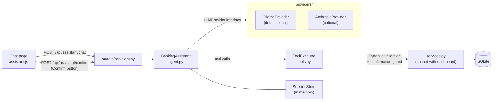

# ClinicBook: Clinic Appointment Booking with a Local AI Assistant

A web app for a small clinic to publish doctors' schedules and book patient appointments.
Staff manage schedules and bookings from a dashboard, and patients can book, check or cancel
appointments by chatting with an **AI booking assistant that runs on a local LLM**.

Built with **FastAPI**, **SQLAlchemy 2.0**, **Jinja2**, **Tailwind CSS** and **Ollama** (`qwen2.5:7b`),
with optional support for the **Claude API**. 184 tests, Docker support.


## Features

**Dashboard**

- **Schedule generation**: create back-to-back slots for a doctor between a start and end time (1–240 minute slots).
- **No duplicate slots**: generating a schedule twice, or with an overlapping range, only adds the free time. A database unique constraint backs this up.
- **Booking rules**:
  - A slot can only be booked once. An atomic update prevents race conditions between simultaneous requests.
  - A patient can't book the same doctor twice on the same day.
  - A patient can't hold two overlapping appointments.
  - Slots that have already started can't be booked.
- **Cancel bookings** to free a slot again.
- **Clear feedback**: every failure (missing slot, already booked, invalid input) shows a specific message.
- **Input validation** with Pydantic: slot duration range, end time after start time, no past dates, required name and phone number.

**AI booking assistant**

- Chat in plain English: *"I want an appointment with a dermatologist tomorrow morning."*
- LLM **tool calling** over the same service layer the dashboard uses.
- **Local-first**: runs on Ollama by default, with no API key and no internet connection.
- **Confirmation enforced in code**: nothing is booked or cancelled until the patient confirms.
- **Privacy**: looking up or cancelling a booking requires the patient's name **and** phone number.

## Tech stack

| Layer | Technology |
|---|---|
| Web framework | FastAPI, Uvicorn |
| Database / ORM | SQLite, SQLAlchemy 2.0 (typed `Mapped` models) |
| Validation | Pydantic v2 |
| Templates / UI | Jinja2, Tailwind CSS (CDN), plain JavaScript |
| LLM | Ollama + `qwen2.5:7b` (default), Anthropic Claude API (optional) |
| Testing | pytest, FastAPI `TestClient`, mocked LLM providers |
| Packaging | Docker, Docker Compose |

## Running locally

Requires Python 3.10+.

```bash
git clone https://github.com/rasoolzoubi2003-dotcom/clinic-dashboard.git
cd clinic-dashboard

python3 -m venv .venv
source .venv/bin/activate
pip install -r requirements.txt

cp .env.example .env        # optional: adjust settings
uvicorn app.main:app --reload
```

Open http://localhost:8000. The database file (`clinic.db`) and the default doctors are created on first start.
The dashboard works on its own. The AI assistant also needs Ollama (see [AI Assistant setup](#setup)).

## Running with Docker

```bash
docker compose up --build
```

This starts three services:

| Service | What it does |
|---|---|
| `app` | the web app on http://localhost:8000 |
| `ollama` | the local LLM server; models are kept in the `ollama-models` volume |
| `ollama-init` | a one-off step that pulls `OLLAMA_MODEL` on first start (about 4.7 GB for `qwen2.5:7b`) |

The dashboard is available immediately. The assistant page shows a notice until the model download finishes
(`docker compose logs -f ollama-init` shows progress).

Data is stored in the `clinic-data` volume and survives restarts. To use a different host port: `APP_PORT=8080 docker compose up --build`.

## Running the tests

```bash
pip install -r requirements-dev.txt
pytest
```

The tests use an in-memory SQLite database and a **scripted fake LLM**, so they need no model, API key or network. They cover:

- the dashboard: schedule generation, duplicate prevention, booking and double-booking rules, cancelling, input validation, HTTP routes
- the assistant tools: argument validation, slot-ID checks, the confirmation guard, name + phone privacy rules
- the agent loop: tool calls written as text, retry and loop limits, provider errors, fallback provider, confirm buttons
- the Ollama and Anthropic adapters, with mocked SDK clients
- the assistant API endpoints

## AI Assistant

The assistant lives at `/assistant`. A patient describes what they need, and the model calls tools to search
for free slots, book, look up or cancel bookings. Every tool goes through `app/services.py`, so the assistant follows
exactly the same booking rules as the dashboard.

### Why local-first

- **Privacy**: patient names, phone numbers and appointment details never leave the machine. Nothing is sent to a third-party API.
- **Zero running cost**: no API key and no per-token billing.
- **Works offline**: once the model is downloaded, no internet connection is needed.

Claude is supported as an optional provider for setups where those trade-offs are different (see [Switching to Claude](#switching-to-claude)).

### Architecture



| Module | Role |
|---|---|
| `assistant/providers/base.py` | Small provider interface: `LLMProvider`, `Conversation`, `ToolCall`, `ToolResult`, and typed `ProviderError`s |
| `assistant/providers/ollama_provider.py` | Ollama adapter (low temperature, clear "run `ollama pull`" errors) |
| `assistant/providers/anthropic_provider.py` | Claude adapter |
| `assistant/agent.py` | The tool loop, shared by every provider, plus limits and fallback |
| `assistant/tools.py` | The 5 tools, argument models, slot-ID checks, confirmation guard |
| `assistant/dates.py` | Turns "tomorrow" or "Sunday" into dates in code |
| `assistant/parsing.py` | Recovers tool calls a model wrote as plain text |

Adding a provider means implementing `LLMProvider` and `Conversation` (about 60 lines) and registering it in `factory.py`.
The tool loop, validation and safety checks don't change.

**Tools exposed to the model:** `list_doctors`, `find_available_slots(doctor, date, time_of_day)`,
`book_slot(slot_id, patient_name, phone_number)`, `find_bookings(patient_name, phone_number)`,
`cancel_booking(slot_id, patient_name, phone_number)`.

### Hardening for small local models

A 7B model is much less reliable at tool calling than a frontier model, so the code doesn't trust it:

- **Low temperature** (0.1 by default, capped at 0.2) for consistent tool calls.
- **Every argument is validated with Pydantic.** Invalid calls get a clear error back (*"date must be YYYY-MM-DD"*) so the model can retry. After 3 invalid calls in one message, the assistant asks the patient to rephrase. Each message is also capped at 6 tool rounds.
- **Slot IDs are never trusted.** `book_slot` only accepts a slot that exists in the database **and** was returned to this chat by `find_available_slots`. A made-up ID is rejected.
- **Confirmation is enforced in code, not just in the prompt.** The first `book_slot` or `cancel_booking` call only returns the details. The change happens when the same call arrives after the patient has replied, or when they press **Confirm** on the card, which acts without the model. A model that tries to "propose and confirm" in one turn can't book anything.
- **The confirmation card is built from the database**, so the patient always sees the real doctor, date and time, even if the model's own text gets a detail wrong.
- **Date arithmetic is done in code.** The model can pass "Sunday" or "tomorrow" and `dates.py` resolves it. In testing, the 7B model mapped "Sunday" to the wrong date on its own.
- **Text instead of tool calls**: if the model writes `{"name": "find_available_slots", ...}` as plain text, the call is recovered and run.
- **Phone numbers** are compared without leading zeros, because small models often turn `0791234567` into `791234567`.
- **Friendly errors**: if Ollama isn't running, the model isn't pulled, a request times out, or Claude is unreachable, the patient sees a clear message and the page shows a setup banner (for example *"Run: ollama pull qwen2.5:7b"*).

### Privacy safeguards

- Every booking requires a phone number.
- `find_bookings` and `cancel_booking` only match when **both** the name and the phone number match.
- A wrong name or phone gives the same "not found" answer as a booking that doesn't exist, so nothing leaks about other patients.
- Tool results never contain other patients' names or phone numbers. The tests check this explicitly.

### Example conversations

These are real conversations with `qwen2.5:7b` running locally, with timings removed.

**Booking**

> **Patient:** I want an appointment with a dermatologist tomorrow morning
>
> **Assistant:** We have available slots with Dr. Rasool on Sunday 8 November 2026 at 09:00, 09:30, 10:00, 10:30, 11:00, and 11:30. Which time works for you?
>
> **Patient:** 10:00 works. My name is Lina Haddad, phone 0791234567
>
> **Assistant:** These are the details for your appointment with Dr. Rasool on Sunday 8 November 2026 at 10:00. Do you confirm? If yes, I will book it for you.
>
> *(A confirmation card shows: Dr. Rasool (Dermatology), Sunday 8 November 2026, 10:00–10:30, Lina Haddad, 0791234567.)*
>
> **Patient:** Yes, please book it
>
> **Assistant:** Your appointment with Dr. Rasool for dermatology on Sunday 8 November 2026 at 10:00 has been booked. Please remember to arrive on time.

**Cancelling (asks for missing details first)**

> **Patient:** I need to cancel my appointment
>
> **Assistant:** Sure, I can help with that. Could you please provide me with your full name and the phone number used when booking the appointment?
>
> **Patient:** Lina Haddad, 0791234567
>
> **Assistant:** I found your appointment on Monday 9 November 2026 at 11:00 AM with Dr. Zoubi for Cardiology. Please confirm if you want to cancel this appointment.
>
> *(The patient presses **Confirm** on the card.)*
>
> **Assistant:** Your appointment with Dr. Zoubi on Monday 9 November 2026 at 11:00 has been cancelled.

### Setup

**Option A: Docker (easiest).** `docker compose up --build` starts Ollama and pulls the model automatically.

**Option B: Ollama installed on the host (fastest on Linux).**

```bash
curl -fsSL https://ollama.com/install.sh | sh   # see https://ollama.com/download
ollama pull qwen2.5:7b
uvicorn app.main:app --reload                  # OLLAMA_HOST defaults to http://localhost:11434
```

Then open http://localhost:8000/assistant.

**Hardware requirements**

- `qwen2.5:7b` needs about **8 GB of free RAM** (the model is ~4.7 GB on disk and ~5 GB in memory).
- A GPU makes replies much faster. On a CPU only, expect slow replies: on a laptop i7 inside Docker Desktop (8 GB VM) we measured about 1.6 tokens/s, or roughly 1–2 minutes per reply.
- Running Ollama natively instead of in Docker Desktop's VM, or using a GPU, helps a lot. A smaller model (`OLLAMA_MODEL=qwen2.5:3b`) is faster but less reliable at tool calling.

### Switching to Claude

Claude is optional and only used when it is explicitly selected **and** an API key is set:

```bash
# .env
LLM_PROVIDER=anthropic
ANTHROPIC_API_KEY=sk-ant-...
ANTHROPIC_MODEL=claude-haiku-5-5
```

Note that with Claude, chat messages, including patient names and phone numbers, are sent to the Anthropic API.

To keep the local model as primary and use Claude only when Ollama is unavailable, set `LLM_PROVIDER=ollama` and
`LLM_FALLBACK_PROVIDER=anthropic`. The fallback is off by default.

### Limitations

- **Chat sessions are kept in memory.** Conversations are lost when the server restarts and aren't shared between
  multiple server processes; sessions also expire after 2 hours of inactivity. Bookings themselves are always saved
  in the database. A production deployment would store sessions in Redis or the database.
- English only.
- No user accounts: the name + phone check is a lightweight identity check, not authentication.

## Configuration

All settings are read from environment variables or a `.env` file (see `.env.example`). The API key is never hardcoded.

| Variable | Default | Description |
|---|---|---|
| `DATABASE_URL` | `sqlite:///./clinic.db` | SQLAlchemy database URL |
| `CLINIC_TIMEZONE` | `Asia/Amman` | Timezone used for "today" and for rejecting past dates |
| `LLM_PROVIDER` | `ollama` | `ollama` (local) or `anthropic` |
| `LLM_FALLBACK_PROVIDER` | *(empty)* | Optional provider to use if the first one fails |
| `OLLAMA_HOST` | `http://localhost:11434` | Ollama server URL |
| `OLLAMA_MODEL` | `qwen2.5:7b` | Local model name |
| `OLLAMA_TEMPERATURE` | `0.1` | Sampling temperature, kept within 0–0.2 |
| `OLLAMA_TIMEOUT` | `120` | Seconds to wait for a reply |
| `ANTHROPIC_API_KEY` | *(empty)* | Only needed for Claude |
| `ANTHROPIC_MODEL` | `claude-haiku-5-5` | Claude model |

## Project structure

```
clinic-dashboard/
├── app/
│   ├── main.py              # FastAPI app, startup (create tables, seed doctors), /health
│   ├── config.py            # settings from environment / .env
│   ├── database.py          # engine, session factory, Base, get_db dependency
│   ├── models.py            # Doctor and Appointment ORM models
│   ├── schemas.py           # Pydantic validation for form input
│   ├── services.py          # business logic shared by dashboard and assistant
│   ├── messages.py          # user-facing error/success text
│   ├── migrations.py        # adds new nullable columns to existing SQLite databases
│   ├── seed.py              # default doctors
│   ├── clock.py             # current date/time in the clinic's timezone
│   ├── templating.py        # shared Jinja2 environment
│   ├── assistant/
│   │   ├── agent.py         # tool loop, limits, fallback, confirm buttons
│   │   ├── tools.py         # tool definitions, validation, confirmation guard
│   │   ├── prompts.py       # system prompt
│   │   ├── dates.py         # "tomorrow" / "Sunday" -> date
│   │   ├── parsing.py       # tool calls written as plain text
│   │   ├── sessions.py      # in-memory chat sessions
│   │   ├── texts.py         # fixed replies
│   │   └── providers/       # base interface, Ollama, Anthropic, factory
│   ├── routers/
│   │   ├── appointments.py  # dashboard
│   │   └── assistant.py     # chat page + JSON API
│   ├── templates/           # base.html, home.html, assistant.html
│   └── static/              # css/app.css, js/assistant.js
├── tests/                   # pytest suite (184 tests)
├── docs/screenshot.png
├── Dockerfile
├── docker-compose.yml       # app + ollama + model pull
├── requirements.txt         # runtime dependencies (pinned)
├── requirements-dev.txt     # + test dependencies
└── .env.example
```

### Design notes

- **Thin routes, testable services.** Routes only parse input and pick a response; all rules live in `services.py`, which raises typed errors (`SlotNotFound`, `PatientAlreadyBooked`, …). The dashboard and the AI tools both call it.
- **Post/Redirect/Get.** Every dashboard form post redirects back. Only message *codes* go in the URL, never raw text, so a crafted link can't inject content into the page.
- **Tailwind via CDN** keeps the project free of a Node build step. For production you would compile Tailwind into a static CSS file.
- **Schema changes** are applied with `create_all` plus a small add-missing-columns step on startup, which is fine for a demo. A production deployment would use Alembic migrations.
