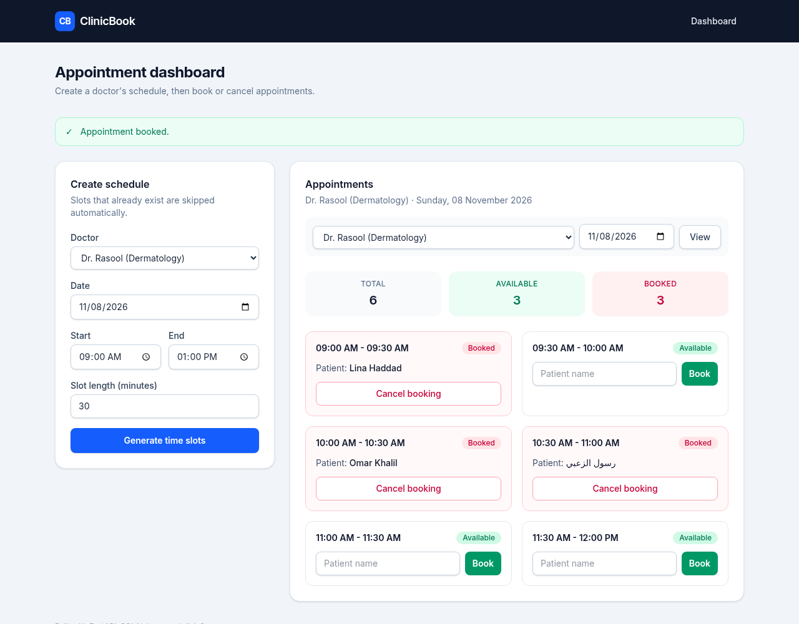

# ClinicBook: Clinic Appointment Booking

A web app for a small clinic to publish doctors' schedules and book patient appointments.
Staff create time slots for a doctor on a given day, then book or cancel appointments from a single dashboard.

Built with **FastAPI**, **SQLAlchemy 2.0**, **Jinja2** and **Tailwind CSS**, with a tested service layer and Docker support.



## Features

- **Schedule generation**: create back-to-back slots for a doctor between a start and end time (1–240 minute slots).
- **No duplicate slots**: generating a schedule twice, or with an overlapping range, only adds the free time. A database unique constraint backs this up.
- **Booking rules**:
  - A slot can only be booked once. An atomic update prevents race conditions between simultaneous requests.
  - A patient can't book the same doctor twice on the same day.
  - A patient can't hold two overlapping appointments.
  - Slots that have already started can't be booked.
- **Cancel bookings** to free a slot again.
- **Clear feedback**: every failure (missing slot, already booked, invalid input) shows a specific message, and successful actions are confirmed.
- **Input validation** with Pydantic: slot duration range, end time after start time, no past dates, and a required patient name.
- **Persistent storage** in SQLite, configurable through `DATABASE_URL`.
- **Responsive UI** that works on desktop and mobile.

## Tech stack

| Layer | Technology |
|---|---|
| Web framework | FastAPI, Uvicorn |
| Database / ORM | SQLite, SQLAlchemy 2.0 (typed `Mapped` models) |
| Validation | Pydantic v2 |
| Templates / UI | Jinja2, Tailwind CSS (CDN) |
| Testing | pytest, FastAPI `TestClient` |
| Packaging | Docker, Docker Compose |

## Running locally

Requires Python 3.10+.

```bash
git clone https://github.com/rasoolzoubi2003-dotcom/clinic-dashboard.git
cd clinic-dashboard

python3 -m venv .venv
source .venv/bin/activate
pip install -r requirements.txt

cp .env.example .env        # optional: change DATABASE_URL or CLINIC_TIMEZONE
uvicorn app.main:app --reload
```

Open http://localhost:8000. The database file (`clinic.db`) and the default doctors are created on first start.

### Configuration

| Variable | Default | Description |
|---|---|---|
| `DATABASE_URL` | `sqlite:///./clinic.db` | SQLAlchemy database URL |
| `CLINIC_TIMEZONE` | `Asia/Amman` | Timezone used for "today" and for rejecting past dates |

## Running with Docker

```bash
docker compose up --build
```

Open http://localhost:8000. The SQLite database is stored in the `clinic-data` volume, so data survives container restarts and rebuilds.
To use a different host port: `APP_PORT=8080 docker compose up --build`.

## Running the tests

```bash
pip install -r requirements-dev.txt
pytest
```

The tests use an in-memory SQLite database and cover:

- schedule generation
- duplicate prevention
- booking and double-booking rules
- cancelling
- input validation
- the HTTP routes

## Project structure

```
clinic-dashboard/
├── app/
│   ├── main.py            # FastAPI app, startup (create tables, seed doctors), /health
│   ├── config.py          # settings from environment / .env
│   ├── database.py        # engine, session factory, Base, get_db dependency
│   ├── models.py          # Doctor and Appointment ORM models
│   ├── schemas.py         # Pydantic validation for form input
│   ├── services.py        # business logic: generate, list, book, cancel
│   ├── messages.py        # user-facing error/success text
│   ├── seed.py            # default doctors
│   ├── clock.py           # current date/time in the clinic's timezone
│   ├── templating.py      # shared Jinja2 environment
│   ├── routers/
│   │   └── appointments.py
│   ├── templates/         # base.html, home.html
│   └── static/css/app.css
├── tests/                 # pytest suite
├── docs/screenshot.png
├── Dockerfile
├── docker-compose.yml
├── requirements.txt       # runtime dependencies (pinned)
├── requirements-dev.txt   # + test dependencies
└── .env.example
```

### Design notes

- **Thin routes, testable services.** Routes only parse input and pick a redirect; all rules live in `services.py`, which raises typed errors (`SlotNotFound`, `PatientAlreadyBooked`, …). Each error carries a short code that the UI maps to a message.
- **Post/Redirect/Get.** Every form post redirects back to the dashboard. Only message *codes* go in the URL, never raw text, so a crafted link can't inject content into the page.
- **Tailwind via CDN** keeps the project free of a Node build step. For production you would compile Tailwind into a static CSS file.
- **Schema changes** are applied with `create_all` on startup, which is fine for a demo. A production deployment would add Alembic migrations.
